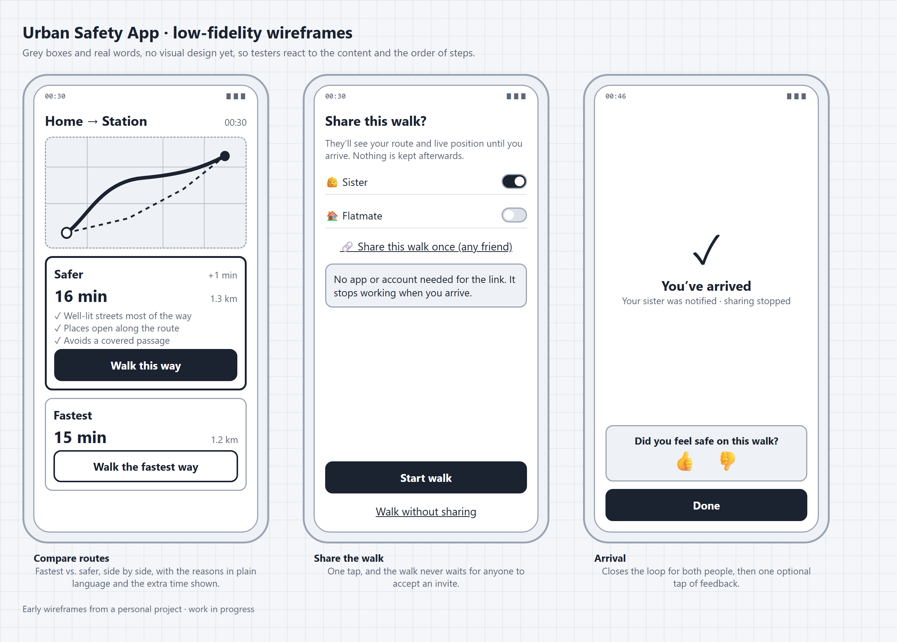

# Urban Safety App

*Product discovery for an app that helps people choose a safer walking route at night. A personal project by [Marta Pereira](https://linkedin.com/in/martamspereira), built in the open.*

> **Status:** discovery and early prototype · **Next:** first tests with potential users

---

## The idea in one paragraph

Navigation apps choose the **fastest** route. But after dark, how safe a street *feels* depends on things those apps ignore: lighting, whether places are open, whether there are people around, stairs or underpasses with no way out. This app compares the fastest route with a **safer** one, explains **why** it’s safer in plain language, and lets someone you trust follow your walk until you arrive.

## Who it’s for

People walking an **unfamiliar** area at night, starting with newcomers to the city (students, people who have just moved), who don’t yet know which streets feel comfortable after dark.

## What’s in this repository

| Folder | What you’ll find |
|---|---|
| [`discovery/problem.md`](discovery/problem.md) | The problem, who has it and how they deal with it today |
| [`discovery/user-research.md`](discovery/user-research.md) | Hypotheses about users, how confident I am in each, and how I’ll test them |
| [`discovery/decisions.md`](discovery/decisions.md) | Key product decisions and trade-offs, including what I chose *not* to build |
| [`discovery/experiments.md`](discovery/experiments.md) | Planned experiments, with success criteria set before running them |
| [`design/`](design/) | Low-fidelity wireframes |

## Principles

- **Describe places, never people.** Explanations refer to conditions (lighting, open places, street layout), never to who is around.
- **Say “safer”, never “safe”.** The app can’t guarantee safety and shouldn’t pretend to.
- **Privacy by design.** Sharing is off by default and no location history is kept.
- **Be honest about uncertainty.** When two routes are too similar to call, say so.

## Early wireframes

## Roadmap

- [x] Problem, target users and scope of a first version
- [x] Features prioritised by value and effort
- [x] User flow and low-fidelity wireframes
- [x] Early prototype (built with AI tools)
- [ ] First sessions with potential users: interviews + route comparison test
- [ ] Usability test of the wireframes with 3–5 people
- [ ] Decide: build the MVP, adjust, or stop, based on the results

---

*This repository documents the product thinking. Some details (how routes are scored, data sources, business model) are kept private while the project is in development. Feedback is welcome.*
